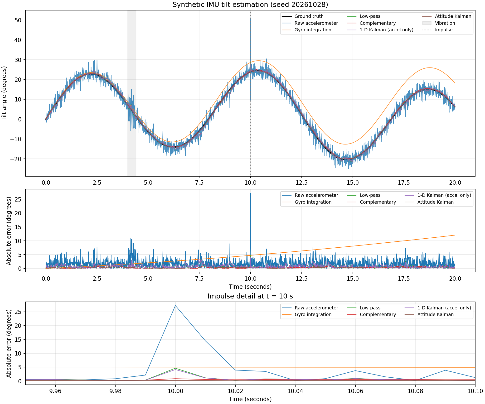

# mecha-imu-filter

[](https://github.com/Dtunder/mecha-imu-filter/actions/workflows/tests.yml)

Small scalar filters for estimating tilt from noisy IMU measurements. The gyro follows motion quickly but accumulates bias; the accelerometer provides an absolute angle reference that is noisy and can be disturbed by vibration. This repository includes low-pass, complementary, accel-only scalar Kalman, and gyro/accelerometer fusion Kalman filters, plus a reproducible synthetic comparison.

## Filter models

Let `theta_acc` be an accelerometer-derived angle, `omega` the gyro rate, and `dt` the sample interval.

- **Low-pass:** `y[k] = alpha * x[k] + (1 - alpha) * y[k-1]`
- **Complementary:** `theta[k] = alpha * (theta[k-1] + omega[k] * dt) + (1 - alpha) * theta_acc[k]`
- **1-D Kalman (accel only):** scalar random-walk prediction and accelerometer correction. It does not use the gyro.
- **Attitude Kalman:** estimates `x = [theta, b]`, where `b` is gyro bias. With `F = [[1, -dt], [0, 1]]` and `g = [dt, 0]^T`:

  ```text
  x- = F x + g omega                 P- = F P F^T + Qd
  z  = H x- + v, H = [1, 0]          S  = H P- H^T + R_measure
  K  = P- H^T / S                    x  = x- + K (z - H x-)
  P  = (I - K H) P-
  ```

  `q_angle` and `q_bias` set the continuous-time process-noise intensities; the discrete covariance uses `Qd = diag(q_angle * dt, q_bias * dt)`. `r_measure` is accelerometer-angle variance. Angles use degrees, gyro rates degrees/second, and time seconds. An optional `innovation_gate_sigma` rejects an accelerometer update when `abs(z - H x-) > gate * sqrt(S)`; the gyro prediction and covariance are retained for that sample. Gating is off by default.

The existing `KalmanFilter` API is unchanged. Its benchmark label is **1-D Kalman (accel only)** to make its behavior explicit. The fusion implementation is `AttitudeKalmanFilter` in [`filters.py`](filters.py).

## Synthetic benchmark

The 20-second, 100 Hz scenario has a known two-frequency tilt trajectory, gyro bias `0.35 + 0.025*t` deg/s, gyro white noise with `0.12 deg/s` standard deviation, and accelerometer-angle noise with `2.2 deg` standard deviation. The accelerometer angle also includes two short vibration bursts and two impulse samples at `t = 10 s`. Metrics include all samples, including startup and disturbances.

Fusion parameters were selected without using evaluation seeds. `r_measure = 2.2^2 = 4.84 deg^2` comes from the simulated accelerometer noise. `q_angle = 0.12^2 * 0.01 = 0.000144 deg^2/s` follows from the sampled gyro noise variance at 100 Hz. A small grid over `q_angle` in `{1.44e-5, 1.44e-4, 1.44e-3, 1.44e-2}` and `q_bias` in `{1e-4, 3e-4, 1e-3, 2e-3, 3e-3, 5e-3}` was scored on tuning seeds `314159`, `314160`, and `314161`. The noise-derived `q_angle` was retained; `q_bias = 0.005 (deg/s)^2/s` had the lowest mean RMSE in that row. The 4-sigma innovation gate is fixed and rejects the injected large impulse.

### Single-seed results

The fixed evaluation seed is `20261028`. The reported lag is the maximum normalized cross-correlation with truth over shifts from `-0.50 s` to `+0.50 s`; positive lag means the estimate trails truth. Values below are rounded to two decimals; [`metrics.csv`](results/metrics.csv) stores six decimals.

| Estimator | RMSE (deg) | Max abs. error (deg) | Lag (s) |
|---|---:|---:|---:|
| Raw accelerometer | 2.41 | 27.23 | 0.01 |
| Gyro integration | 6.23 | 12.02 | -0.01 |
| Low-pass | 0.86 | 4.61 | 0.05 |
| Complementary | 0.40 | 0.98 | 0.01 |
| 1-D Kalman (accel only) | 0.88 | 4.12 | 0.06 |
| Attitude Kalman | 0.27 | 0.63 | 0.01 |

### 20-seed RMSE

The evaluation seeds are `20261028` through `20261047`; they do not overlap the tuning seeds. This table reports the mean and population standard deviation (`ddof=0`) of per-seed RMSE. [`metrics_multiseed.csv`](results/metrics_multiseed.csv) stores the values to six decimals.

| Estimator | RMSE mean ± std (deg) |
|---|---:|
| Raw accelerometer | 2.424 ± 0.025 |
| Gyro integration | 6.220 ± 0.037 |
| Low-pass | 0.854 ± 0.024 |
| Complementary | 0.356 ± 0.047 |
| 1-D Kalman (accel only) | 0.861 ± 0.025 |
| Attitude Kalman | 0.212 ± 0.043 |

On this scenario, Attitude Kalman has lower single-seed RMSE and maximum absolute error than Complementary; both have `0.01 s` lag to the reported precision. Complementary remains a useful low-computation option because it has no covariance propagation or innovation gate. The 1-D Kalman result is intentionally retained as an accel-only baseline.



## Reproduce

```bash
python -m pip install -r requirements.txt
python benchmark.py
python -m pytest -p no:cacheprovider
python run_tests.py
```

`python benchmark.py` regenerates both CSV files and the single-seed figure. The benchmark parameters and fixed seed lists are in [`benchmark.py`](benchmark.py). NumPy and Matplotlib are used by the benchmark; pytest runs the test suite.

## Limitations

This is a synthetic angle-level comparison, not physical-sensor or hardware validation. It does not model 3D orientation, axis alignment, gravity projection during dynamic motion, temperature effects, sensor calibration, or platform timing. The reported results describe the stated motion/noise profile and do not establish universal real-world accuracy.
